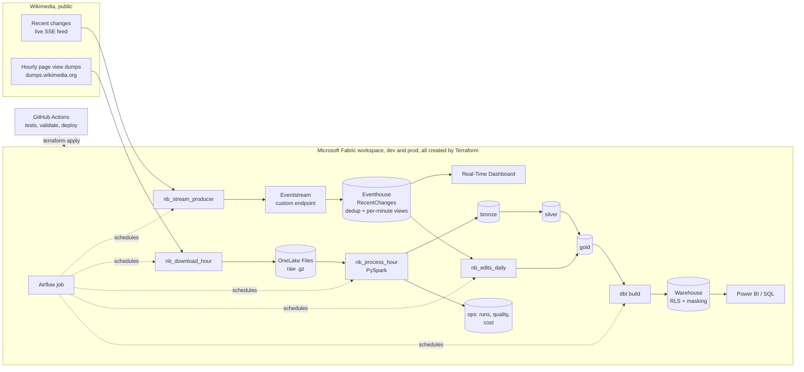

# Wikipulse: real-time and batch analytics of Wikipedia activity on Microsoft Fabric

[](https://github.com/munyingi/wikipulse/actions/workflows/ci.yml)

Wikipulse watches what the world reads and edits on Wikipedia. A **streaming path** takes every edit to every Wikimedia wiki (dozens per second, live) into an Eventhouse for second-level dashboards. A **batch path** processes Wikimedia's hourly page view dumps (millions of rows per hour) with PySpark into a Delta medallion lakehouse, and dbt builds a secured serving warehouse on top. Everything is deployed with **Terraform**, orchestrated by **Apache Airflow**, monitored, costed and shipped through **GitHub Actions**.

All data is real and public. Everything runs on the free 60-day Microsoft Fabric trial.

## What it demonstrates

| Skill | Where |
|---|---|
| **Microsoft Fabric** end to end: lakehouse, warehouse, Eventstream, Eventhouse (KQL), notebooks, Airflow job | the whole repo |
| **Spark at scale**: idempotent hourly loads with `replaceWhere`, MERGE upserts, skew-aware salted joins, AQE, V-Order, OPTIMIZE / Z-ORDER / VACUUM | [`src/wikipulse`](src/wikipulse), [`notebooks/src`](notebooks/src) |
| **Streaming**: live Server-Sent Events -> Eventstream -> Eventhouse, at-least-once delivery made exactly-once with a deduplicating materialized view, anomaly detection in KQL | [`recentchanges.py`](src/wikipulse/recentchanges.py), [`kql/`](kql) |
| **Infrastructure as code**: every Fabric item, dev and prod workspaces, role assignments, via the `microsoft/fabric` Terraform provider | [`terraform/`](terraform) |
| **Orchestration**: Airflow DAGs for hourly, daily, backfill, monitoring and streaming work; item IDs injected by Terraform | [`airflow/dags`](airflow/dags) |
| **Modelling and serving**: dbt on the Fabric warehouse, reading gold tables across items | [`dbt/`](dbt) |
| **Security and governance**: row-level security by language, dynamic data masking of editor names, least-privilege workspace roles, secrets in Key Vault, OIDC deploys with no stored secret | [`dbt/macros/security.sql`](dbt/macros/security.sql), [`deploy.yml`](.github/workflows/deploy.yml) |
| **Running in production**: data quality gates, freshness SLA checks, failure alerts to Teams or Slack, run log, runbook | [`quality.py`](src/wikipulse/quality.py), [`docs/runbook.md`](docs/runbook.md) |
| **Cost**: capacity units and euros per run, rolled up daily | [`ops.py`](src/wikipulse/ops.py), [`docs/cost.md`](docs/cost.md) |
| **CI/CD**: Spark + Delta tests, `terraform validate`, `dbt parse`, Airflow DAG import test; manual, approval-gated deploys | [`.github/workflows`](.github/workflows) |

## Architecture



## The batch path

| Layer | Table | Grain | How it is written |
|---|---|---|---|
| raw | `Files/raw/pageviews/YYYY/MM/DD/*.gz` | one file per hour | downloaded to a temp name, gzip-checked, then renamed; never overwritten |
| bronze | `bronze.pageviews_raw` | one row per line | `replaceWhere hour_utc = ...`; malformed lines kept with their raw text |
| silver | `silver.page_views_hourly` | hour, wiki, access, page | `replaceWhere` one hour; domain codes decoded (`en.m` is mobile Wikipedia, `commons.m` is desktop Commons) |
| gold | `gold.wiki_hourly_traffic`, `gold.daily_page_views`, `gold.top_pages_daily`, `gold.trending_pages`, `gold.edits_vs_views`, `gold.editors_daily` | hour or day | the affected day is recomputed from silver, so late or re-run hours are always correct |
| ops | `ops.hour_status`, `ops.quality_results`, `ops.pipeline_runs`, `ops.cost_daily` | per run / hour / check | MERGE upserts |

**Idempotency.** Re-running any hour replaces exactly that hour; the test suite proves that a re-run or a backfill leaves every count unchanged.

**Backfill.** `ops.hour_status` records each successfully loaded hour. The backfill DAG computes the missing hours in a window and loads only those.

**Skew.** A few pages (Main_Page, Special:Search) carry a large share of all views. The views-to-edits join salts those keys across 16 buckets, and adaptive query execution handles the rest.

**Quality gates.** Every hour checks row counts, malformed-line ratio, nulls, uniqueness and volume against the recent average. Error-level failures stop the hour before gold is touched and alert; warnings are recorded.

## The streaming path

`nb_stream_producer` reads the public recent-changes feed, flattens each event (dropping the edit comment) and sends batches to the Eventstream custom endpoint. Eventstream delivers into the `RecentChanges` table. Because delivery is at least once, the `RecentChangesDedup` materialized view keeps one row per `event_id`; dashboards and exports read from it. KQL functions in [`kql/DatabaseSchema.kql`](kql/DatabaseSchema.kql) power the dashboard: most edited pages, edit spikes (`series_decompose_anomalies`), bot share per wiki, and ingestion lag.

## Security

* **Row-level security**: analysts only see the languages granted to them in [`seeds/analyst_language_access.csv`](dbt/seeds/analyst_language_access.csv) (`*` = all).
* **Dynamic data masking**: `fct_editor_activity_daily.editor` shows `Ex****` to anyone without `UNMASK`.
* **Least privilege**: extra principals get workspace roles from Terraform (`workspace_roles`); the producer reads its connection string from Key Vault at run time.
* **No stored deploy secret**: GitHub Actions authenticates to Fabric and Azure with OIDC federation.

## Run it

Locally, without Fabric (Spark on your laptop, synthetic files in the real dump format):

```bash
python3.11 -m venv .venv && source .venv/bin/activate
pip install -e ".[dev,local]"
pytest -q                      # 32 tests, including Delta idempotency and backfill
wikipulse-local --hours 6 --skip 3   # loads 5 hours, detects the gap, backfills it
```

On Fabric: follow [docs/setup.md](docs/setup.md) (about 30 minutes, free trial). In short:

```bash
az login
export FABRIC_USE_CLI=true TF_VAR_capacity_id=<trial capacity id>
cd terraform && terraform init && terraform workspace new dev
terraform apply -var-file=envs/dev.tfvars
cd .. && pip install -e ".[deploy]" && python scripts/deploy.py --env dev
```

## Repository layout

```
src/wikipulse/      Spark transforms, Delta IO, quality, ops/cost, downloader, stream producer
notebooks/src/      notebook sources (plain Python); scripts/build_notebooks.py makes the Fabric format
kql/                Eventhouse schema, materialized views, functions, dashboard queries
terraform/          Fabric workspace and items for dev and prod
airflow/dags/       hourly, daily, backfill, freshness and streaming DAGs
dbt/                warehouse marts, row-level security and masking
scripts/deploy.py   uploads the package to OneLake and the DAGs + dbt project to the Airflow job
docs/               setup guide, runbook, cost model
```

## Limits and honest notes

* The Eventstream and Airflow job definitions follow Microsoft's published definition formats; preview features can change, so check `terraform apply` output on first deploy.
* The trial capacity is shared by all workloads. The producer runs 55 minutes per hour to leave headroom; pause its DAG when you do not need the live feed.
* Cost figures are estimates from Spark vCore-seconds (1 CU = 2 Spark vCores) and a configurable price per CU hour.

## License

MIT
